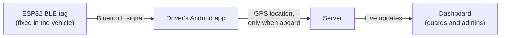
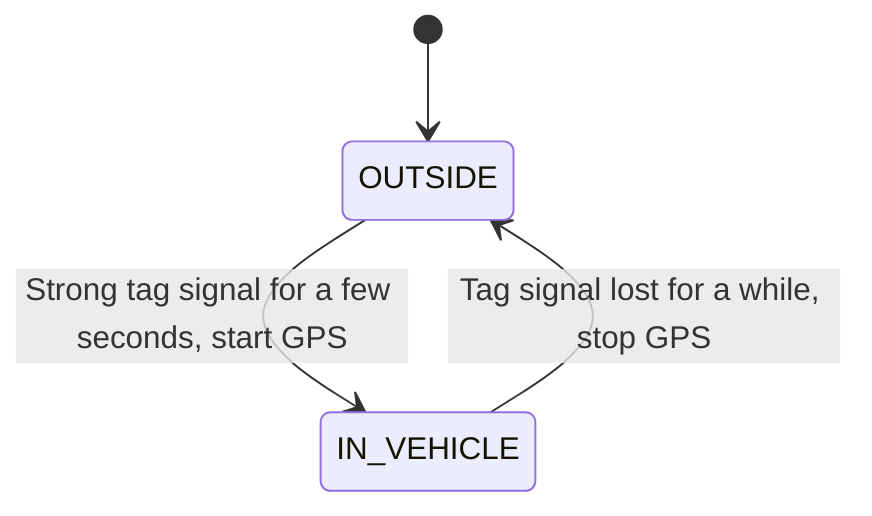

# HILLSync 🚌📍

**A tiny Bluetooth tag that tells the system who is really driving, so buses on narrow hill roads stop meeting each other head-on.**

Built by **Team SpicyX** for the **Ecclesia 4.0 Hackathon** at Assam Down Town University.
Problem Statement: *Open Innovation – Technology-Driven Solutions for Real-World Problems* (PS ID: ECCLISIA26-003)

---

## The problem

Our campus sits on a hill, and its roads are so narrow that two buses can't pass each other. When one vehicle comes from the opposite side, one driver has to stop and wait, or reverse to a wider spot.

Drivers have no way of knowing what is coming around the bend, so this happens again and again. It wastes time, stresses the drivers, and is genuinely risky on a steep, narrow road.

## Our idea in one minute

If everyone could see where the shuttles are, drivers could wait at a wide spot *before* entering a narrow stretch, instead of meeting another bus in the middle of it.

The tricky part is getting reliable live locations without expensive hardware. So we split the job:

- The **driver's phone** already has GPS and internet, so it does the tracking.
- A **cheap Bluetooth tag** (an ESP32 board) is fixed inside each vehicle. It does one thing: say "I am vehicle number X".
- When the phone hears the tag strongly, it knows *this driver is in this vehicle* and starts sharing its location. When the driver walks away, the signal fades and the phone **stops sharing by itself**.

No logging in, no pressing start, nothing to forget.

## How it solves the problem

| Challenge | What BLEtracker does |
|---|---|
| Drivers can't see other vehicles coming | Live map shows every active shuttle in real time |
| A phone's GPS doesn't say *which* bus it is in | The tag's ID links the location to the right vehicle |
| Drivers swap buses or step out for a break | Tracking follows the driver automatically and stops when they leave |
| Dedicated GPS trackers are costly | A tag costs very little and drivers already own phones |
| Always-on tracking raises privacy worries | Location is shared only while the driver is aboard |

## How it works



The app decides whether the driver is in the vehicle like this:



Two small details make it dependable. First, the app averages the signal over several seconds, because Bluetooth strength jumps around. Second, it uses different thresholds for "entering" and "leaving", so it doesn't flicker on and off at the edge of the range.

## What's in this repo

```
BLEtracker/
├── android-app/     Driver app (Kotlin). Listens for the tag, shares GPS when aboard
├── server/          Receives locations and serves the live map dashboard
├── esp32-beacon/    Sketch that turns an ESP32 into the vehicle tag
└── docs/            Slides, diagrams, screenshots and the testing guide
```

Each folder has its own short README with setup steps.

## Tech at a glance

- **Tag:** ESP32 broadcasting an iBeacon-style Bluetooth signal, with adjustable power so the range can be tuned to a vehicle cabin
- **Driver app:** Android (Kotlin and Jetpack Compose), running as a background service so it keeps working with the screen off
- **Server and dashboard:** Node.js with WebSocket, plus a browser map using Leaflet and OpenStreetMap

## Try it yourself

1. **Flash the tag:** open `esp32-beacon/` in the Arduino IDE and upload it to an ESP32. Set a vehicle ID in the sketch.
2. **Start the server:** run it from `server/` on a PC. It prints the address to use.
3. **Install the app:** build `android-app/` in Android Studio, enter the server address and the tag's UUID, and start the service.
4. **Open the dashboard** in a browser on the same network, then walk towards and away from the tag to watch tracking start and stop.

The phone and the PC need to be on the same WiFi for the local demo.

## What we've learned (and are being honest about)

- **Bluetooth strength isn't a ruler.** Metal bodies and people change it, so we calibrate the thresholds inside real vehicles instead of trusting a formula.
- **Phones love to kill background apps.** Drivers must allow background location and exclude the app from battery saving. We guide them through it in the app.
- **Hill roads may have weak mobile signal.** The app is designed to hold locations and send them when the connection returns.

## Roadmap

- [x] Idea, architecture and prototype plan
- [ ] Working MVP: driver app, tag and local dashboard
- [ ] Warnings when a vehicle is about to enter a narrow stretch
- [ ] Student-facing view with live shuttle arrival times
- [ ] Late-night safety sharing, so students can share their live ride with parents or guardians
- [ ] Cloud hosting and a pilot across the full fleet
- [ ] Support for other narrow-road areas such as hill towns and mines

## Why not just...?

**...put a GPS tracker in every vehicle?** It works, but each unit needs its own SIM and data plan. Our approach reuses the phone drivers already carry.

**...use an AirTag?** AirTags depend on passing iPhones to report a location, which is too slow and sparse for a small campus. We borrowed the idea of a small Bluetooth tag, but let the driver's own phone do the real-time work.

## Team

**Team SpicyX**, Assam Down Town University, Guwahati

<!-- Add team member names and the demo video link here before submitting -->

## License

Released under the MIT License. See `LICENSE`.
